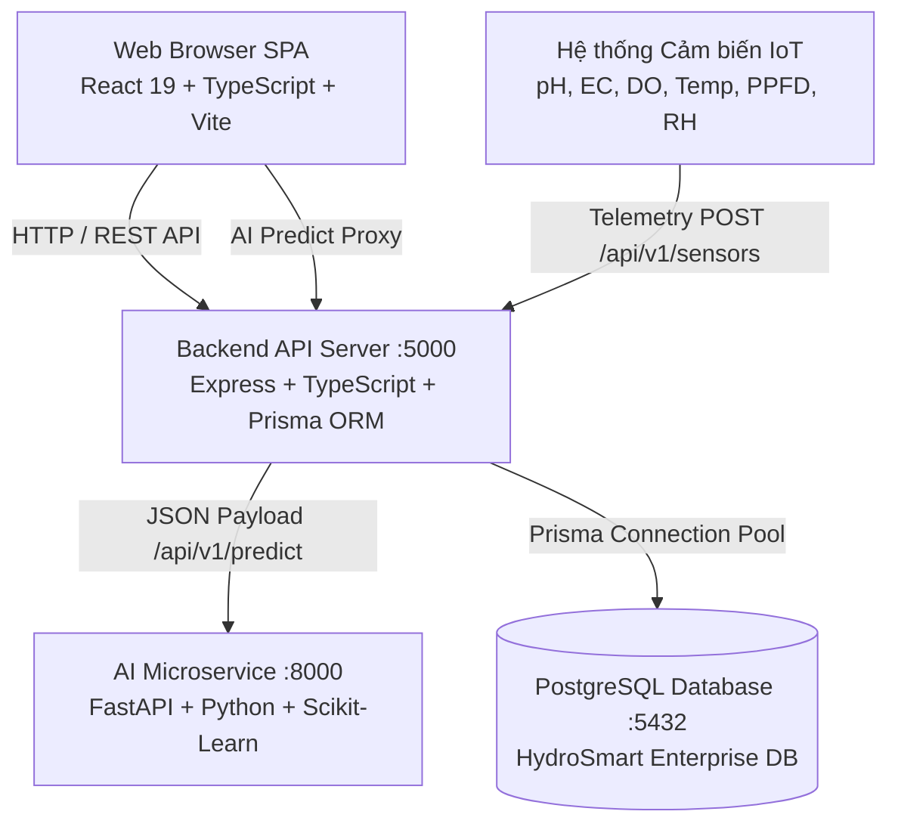
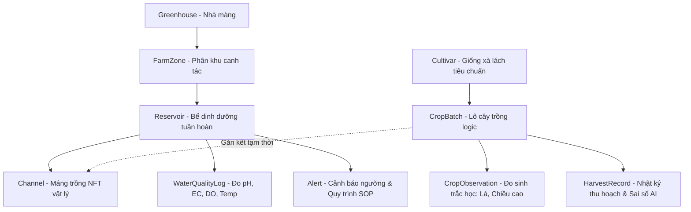

# 🌿 HYDROSMART: CẨM NANG TOÀN TẬP KIẾN THỨC, THUẬT NGỮ & TÀI LIỆU TRÌNH BÀY DỰ ÁN
> **Smart Hydroponic Farm Management System with Big Data Analytics and AI-based Yield Prediction**  
> *Hệ Thống Quản Lý Trang Trại Thủy Canh Thông Minh Tích Hợp Big Data và AI Dự Báo Năng Suất*

---

## 📌 MỤC LỤC
1. [Tổng Quan Đề Tài & Mục Tiêu Cốt Lõi](#1-tổng-quan-đề-tài--mục-tiêu-cốt-lõi)
2. [Kiến Thức Nông Học & Thủy Canh Chuyên Sâu](#2-kiến-thức-nông-học--thủy-canh-chuyên-sâu)
3. [Các Chỉ Số Lý Hóa, Vi Khí Hậu & Quy Chuẩn Ngưỡng](#3-các-chỉ-số-lý-hóa-vi-khí-hậu--quy-chuẩn-ngưỡng)
4. [Hệ Thống Cảnh Báo Thông Minh (Rule Engine & Alert Lifecycle)](#4-hệ-thống-cảnh-báo-thông-minh-rule-engine--alert-lifecycle)
5. [Trí Tuệ Nhân Tạo & Phân Tích Dữ Liệu Lớn (AI & Big Data)](#5-trí-tuệ-nhân-tạo--phân-tích-dữ-liệu-lớn-ai--big-data)
6. [Kiến Trúc Kỹ Thuật & Mô Hình Thực Thể Cơ Sở Dữ Liệu](#6-kiến-trúc-kỹ-thuật--mô-hình-thực-thể-cơ-sở-dữ-liệu)
7. [Từ Điển Thuật Ngữ Toàn Diện (Glossary A–Z)](#7-từ-điển-thuật-ngữ-toàn-diện-glossary-a-z)
8. [Bộ Câu Hỏi Phản Biện Hội Đồng & Kịch Bản Thuyết Trình](#8-bộ-câu-hỏi-phản-biện-hội-đồng--kịch-bản-thuyết-trình)

---

# 1. TỔNG QUAN ĐỀ TÀI & MỤC TIÊU CỐT LÕI

### 1.1. Bối cảnh & Đặt vấn đề
- **Nông nghiệp truyền thống:** Phụ thuộc nặng nề vào thời tiết, hao phí 80-90% lượng nước ngọt do ngấm sâu và bay hơi, khó kiểm soát dư lượng nitrat ($NO_3^-$), sâu bệnh và năng suất bấp bênh.
- **Thủy canh hồi lưu (NFT):** Tiết kiệm tới 90% nước, tối ưu không gian canh tác đô thị/nhà màng, kiểm soát trực tiếp dinh dưỡng rễ cây.
- **Vấn đề thực tế tại trang trại:**
  1. *Thiếu công cụ số hóa:* Ghi chép nhật ký bằng sổ tay/Excel rời rạc, không đối soát được lịch sử dinh dưỡng.
  2. *Quyết định cảm tính:* Kỹ sư thấy cây chậm lớn thường đổ thêm phân bón, dẫn đến hiện tượng sốc muối làm cháy mép lá (*tipburn*) hoặc ngộ độc rễ.
  3. *Không dự báo được sản lượng:* Rất khó cam kết sản lượng xuất bán trước ngày thu hoạch với chuỗi siêu thị/bếp ăn công nghiệp.
  4. *Rủi ro lệch dinh dưỡng:* Lệch pH gây "khóa ion" (nutrient lockout), kết tủa phân bón gây tắc giàn và thiếu hụt khoáng.

### 1.2. Định vị Đề tài
- **HydroSmart** đóng vai trò là một **Hệ Thống Hỗ Trợ Quyết Định (Decision Support System - DSS)** toàn diện cho Kỹ sư Nông nghiệp (Agronomist) và Người Quản lý Trang trại (Farm Manager).
- Chu trình khép kín 7 phần xuyên suốt hệ thống:
  ```
  [1] Cây trồng ──► [2] Hệ thống NFT ──► [3] Nước ──► [4] Dinh dưỡng Stock A/B ──► [5] Vi khí hậu ──► [6] Sinh trắc & Thu hoạch ──► [7] AI & Cảnh báo
  ```

### 1.3. Cây trồng Thí điểm Chuẩn mực
- **Loài:** Rau xà lách thương phẩm (*Lactuca sativa*).
- **Các giống tiêu biểu (Cultivars):** Green Oak Leaf, Batavia, Romaine (Cos), Lollo Rossa, Butterhead.
- **Lý do chọn:**
  - Chu kỳ sinh trưởng ngắn (35 – 42 ngày), quay vòng vốn nhanh.
  - Phù hợp nhất với công nghệ màng dinh dưỡng NFT.
  - Có các bộ dữ liệu khoa học thực nghiệm công khai lớn (Mendeley, USDA, Frontiers).
  - Năng suất sinh khối được chuẩn hóa rõ ràng: $g/\text{cây}$ và $kg/\text{lô}$.

---

# 2. KIẾN THỨC NÔNG HỌC & THỦY CANH CHUYÊN SÂU

### 2.1. So sánh Hai Hệ Thống Thủy Canh Chủ Đạo
| Tiêu chí so sánh | NFT (Nutrient Film Technique) — *Hệ thống của dự án* | DWC (Deep Water Culture) |
|---|---|---|
| **Cơ chế cấp dưỡng** | Bơm tuần hoàn dung dịch thành một lớp màng mỏng (1–3 mm) chảy qua đáy máng dốc (độ dốc 1–2%). | Rễ cây ngập hoàn toàn trong bể dung dịch thể tích lớn, cây nằm trên bè xốp nổi (*raft*). |
| **Tiếp xúc oxy** | Rễ nằm trong máng vừa hấp thụ màng nước, phần trên của rễ tiếp xúc trực tiếp không khí $\rightarrow$ Oxy rễ cực kỳ dồi dào. | Phụ thuộc 100% vào máy sục khí (*air pump*); nếu mất điện/hỏng sục khí cây sẽ chết ngạt rất nhanh. |
| **Thể tích dung dịch** | Thể tích bể vừa phải, tuần hoàn liên tục $\rightarrow$ Dễ điều chỉnh nhanh pH/EC. | Thể tích dung dịch rất lớn $\rightarrow$ Ổn định nhiệt độ nước tốt hơn nhưng tốn phân bón khi thay bể. |
| **Cây trồng phù hợp** | Cực kỳ tối ưu cho rau ăn lá chu kỳ ngắn (xà lách, cải, rau thơm). | Phù hợp xà lách, dưa chuột, cà chua hoặc rau ngắn ngày. |

### 2.2. Vòng Đời Sinh Trưởng Của Xà Lách (6–7 Giai Đoạn)
Cấu trúc quản lý cây trồng trong hệ thống: `Crop → Cultivar → GrowthStage → StageRequirements`.

```
[1] Seed (Ủ hạt) 
    └── 3 ngày | Bóng tối, độ ẩm 90%, EC: 0, pH: 5.8–6.2, Nước sạch
[2] Germination / Seedling (Cây con giá thể xơ dừa)
    └── 10 ngày | EC: 1.0–1.4 mS/cm, pH: 5.6–6.0, DLI: 10 mol/m²/ngày, rễ bắt đầu đâm ra giá thể
[3] Transplant (Lên giàn máng NFT)
    └── 3 ngày | EC: 1.3–1.6 mS/cm, pH: 5.6–6.0, làm quen màng dinh dưỡng, hồi xanh bén rễ
[4] Vegetative (Sinh trưởng tích lũy sinh khối)
    └── 14 ngày | EC: 1.5–1.9 mS/cm, pH: 5.6–6.2, quang hợp tối đa, tăng số lá và trọng lượng búp
[5] Pre-harvest (Giai đoạn xả đạm trước thu hoạch)
    └── 5 ngày | EC hạ nhẹ 1.3–1.6 mS/cm, giải phóng tồn dư nitrat ($NO_3^-$), cuộn búp chắc
[6] Harvest (Thu hoạch thương phẩm)
    └── 1 ngày | Thu hoạch sáng sớm trước 9h để giữ độ giòn, bọc màng bảo quản lạnh
```

### 2.3. Hóa Học Dinh Dưỡng: 17 Nguyên Tố & Nguyên Tắc Tách Stock A / Stock B
Thực vật cần 17 nguyên tố thiết yếu để phát triển:
- **Từ nước và không khí:** $C, H, O$.
- **Khoáng đa lượng (Macronutrients):** $N$ (Đạm), $P$ (Lân), $K$ (Kali), $Ca$ (Canxi), $Mg$ (Magie), $S$ (Lưu huỳnh).
- **Khoáng vi lượng (Micronutrients):** $Fe$ (Sắt), $Mn$ (Mangan), $Zn$ (Kẽm), $B$ (Bo), $Cu$ (Đồng), $Mo$ (Molypden), $Cl$ (Clo), $Ni$ (Niken).

> ⚠️ **NGUYÊN TẮC VÀNG NÔNG HỌC: TẠI SAO BẮT BUỘC PHẢI TÁCH CAN A VÀ CAN B?**
> - **Can A (Stock A):** Chứa Canxi Nitrat $[Ca(NO_3)_2]$ và Sắt Chelate $[Fe-EDDHA / Fe-DTPA]$.
> - **Can B (Stock B):** Chứa Kali Nitrat $[KNO_3]$, Monopotassium Phosphate $[KH_2PO_4 - MKP]$, Magie Sunfat $[MgSO_4]$ và các muối vi lượng tổng hợp.
> - **Lý do:** Ở nồng độ đậm đặc, nếu hòa chung Can A và Can B vào cùng một thùng chứa:
>   $$Ca^{2+} + SO_4^{2-} \longrightarrow CaSO_4 \downarrow \text{ (Canxi Sunfat - Thạch cao kết tủa trắng không tan)}$$
>   $$3Ca^{2+} + 2PO_4^{3-} \longrightarrow Ca_3(PO_4)_2 \downarrow \text{ (Canxi Photphat kết tủa rắn)}$$
> - **Hậu quả:** 
>   1. Toàn bộ Canxi, Lân và Lưu huỳnh bị mất hoạt tính sinh học, cây không hấp thụ được gây thiếu Canxi (cháy mép lá non).
>   2. Tủa trắng đóng cặn làm tắc nghẽn toàn bộ hệ thống béc phun, ống nhỏ giọt và bơm tuần hoàn NFT.
>   3. Sắt ($Fe$) bị oxy hóa và kết tủa nếu tiếp xúc trực tiếp các ion photphat ở nồng độ cao.

### 2.4. Công Thức Tính Liều Châm Phân Mẹ Bù EC (Dosing Calculator)
Khi nồng độ dẫn điện EC thực tế thấp hơn mục tiêu của giống cây, kỹ sư tính toán thể tích dung dịch mẹ Stock A và Stock B cần châm:
$$\text{Dose (ml mỗi can)} = \frac{(\text{EC}_{\text{target}} - \text{EC}_{\text{current}}) \times \text{Volume}_{\text{bể}}\text{ (L)}}{0.1} \times 10$$
*Quy chuẩn thực nghiệm:* Cứ châm $10\text{ ml}$ Stock A và $10\text{ ml}$ Stock B vào $100\text{ L}$ nước sạch sẽ làm tăng xấp xỉ $0.1\text{ mS/cm}$ EC.

### 2.5. Vòng Đời Dung Dịch Bồn Chứa (Solution Replacement Lifecycle)
Dung dịch thủy canh không thể tái sử dụng vĩnh viễn do tích tụ muối cặn hữu cơ và bài tiết của rễ. Hệ thống số hóa chu trình:
```
[Bể trống / Đã vệ sinh]
       │
       ▼
[Pha dung dịch mới] (NutrientMixingEvent: Nước sạch + Can A + Can B + Chỉnh pH)
       │
       ▼
[Vận hành nuôi dưỡng lô] (Tuần hoàn máng NFT)
       ├── Bù nước hao hụt do thoát hơi (WaterTopUpEvent)
       ├── Châm bù phân mẹ theo EC (NutrientDosingEvent)
       └── Cân bằng pH Up/Down (PHAdjustmentEvent)
       │
       ▼
[Lô kết thúc / Thu hoạch]
       │
       ▼
[Xả bỏ dung dịch cũ] (SolutionDrainEvent: Ghi nhận thể tích xả, pH/EC cuối)
       │
       ▼
[Khử trùng giàn & bồn] (SanitationEvent: Dùng $H_2O_2$ hoặc Chlorine loãng)
       │
       ▼
[Sẵn sàng cho lô mới]
```

---

# 3. CÁC CHỈ SỐ LÝ HÓA, VI KHÍ HẬU & QUY CHUẨN NGƯỠNG

### 3.1. Bộ Chỉ Số Lý Hóa Thiết Yếu Trong Bồn NFT
1. **pH (Độ chua / Kiềm của dung dịch):**
   - *Dải an toàn cho xà lách:* **5.5 – 6.5** (Tối ưu: 5.8 – 6.2).
   - *Ý nghĩa sinh học:* pH quyết định độ hòa tan của các ion khoáng.
     - Nếu $\text{pH} < 5.0$: Rễ bị chua, cháy chóp rễ, ngộ độc nhôm/sắt, ức chế hấp thu Ca, Mg.
     - Nếu $\text{pH} > 6.8$: Hiện tượng "khóa chất" (*nutrient lockout*), Sắt ($Fe$), Lân ($P$), Mangan ($Mn$) bị kết tủa, lá non bị vàng gân (*chlorosis*).
   - *Hóa chất hiệu chỉnh:* Dùng **pH Down** (Axit Phosphoric $H_3PO_4$ / Axit Nitric $HNO_3$) và **pH Up** (Kali Hydroxit $KOH$).
2. **EC (Electrical Conductivity - Độ dẫn điện):**
   - *Đơn vị:* $mS/cm$ hoặc $dS/m$.
   - *Dải an toàn cho xà lách:* **1.2 – 2.0 mS/cm** (Giai đoạn tăng trưởng sinh khối: 1.5 – 1.85 mS/cm).
   - *Ý nghĩa:* Biểu thị tổng lượng ion hòa tan có trong dung dịch.
   - *Nguyên lý phản biện:* **EC không cho biết nồng độ riêng của từng ion N, P, K hay Ca.** EC tụt chỉ phản ánh tổng nồng độ khoáng giảm, bắt buộc châm đồng thời cả Can A và Can B theo tỷ lệ chuẩn.
3. **DO (Dissolved Oxygen - Oxy hòa tan trong nước):**
   - *Đơn vị:* $mg/L$ hoặc $ppm$.
   - *Dải an toàn:* **$> 5.5\text{ mg/L}$** (Ngưỡng nguy cấp: $< 4.5\text{ mg/L}$).
   - *Ý nghĩa:* Rễ cây cần oxy để hô hấp tế bào và chủ động hấp thụ khoáng chất. Nếu thiếu oxy, rễ chuyển sang hô hấp yếm khí, rễ bị thâm đen, tạo điều kiện cho nấm thủy sinh *Pythium* (thối rễ) bùng phát làm sập toàn bộ giàn rau.
4. **Nhiệt độ nước bồn (Water Temperature):**
   - *Dải tối ưu:* **18.0 – 23.5°C**.
   - *Ngưỡng báo động:* **$> 24.5^\circ\text{C}$**.
   - *Mối quan hệ nhiệt - oxy:* Nhiệt độ nước càng cao thì độ hòa tan của oxy ($DO$) càng giảm, trong khi rễ cây lại hô hấp mạnh hơn $\rightarrow$ Gây nghẹt rễ kép.
5. **Độ kiềm nguồn nước (Alkalinity):**
   - *Đơn vị:* $mg/L\ CaCO_3$.
   - *Ý nghĩa:* Khả năng đệm axit của nguồn nước đầu vào. Hai nguồn nước có cùng pH = 7.0 nhưng nước có Alkalinity cao sẽ cần lượng axit gấp nhiều lần để kéo pH về 5.8 so với nước cất hay nước mưa.

### 3.2. Bộ Chỉ Số Vi Khí Hậu Nhà Màng (Microclimate)
1. **Nhiệt độ không khí (Air Temperature):** Tối ưu 18.0 – 26.0°C.
2. **Độ ẩm tương đối (Relative Humidity - RH):** Tối ưu 60 – 75%.
3. **Áp suất hơi thiếu hụt (VPD - Vapor Pressure Deficit):**
   - *Đơn vị:* $kPa$.
   - *Công thức tính:* Tính toán từ Nhiệt độ không khí và Độ ẩm tương đối ($RH$).
   - *Dải tối ưu cho rau ăn lá:* **0.8 – 1.2 kPa**.
   - *Cơ chế:* 
     - $\text{VPD} < 0.5\text{ kPa}$ (Quá ẩm): Cây không thể thoát hơi nước $\rightarrow$ Dòng vận chuyển Canxi từ rễ lên chóp lá bị đình trệ $\rightarrow$ Gây **cháy mép lá (tipburn)**.
     - $\text{VPD} > 1.5\text{ kPa}$ (Quá khô): Cây thoát hơi nước quá nhanh $\rightarrow$ Khí khổng đóng lại để chống mất nước, quang hợp ngừng trệ, cây còi cọc.
4. **Cường độ ánh sáng & Tích lũy bức xạ:**
   - **PPFD (Photosynthetic Photon Flux Density):** Mật độ photon quang hợp hữu hiệu ($\mu mol/m^2/s$). Chuẩn xà lách: $150 - 250\ \mu mol/m^2/s$.
   - **DLI (Daily Light Integral):** Tổng tích lũy ánh sáng quang hợp trong cả ngày ($mol/m^2/day$). Chuẩn xà lách: $13 - 17\ mol/m^2/day$.

### 3.3. Quy Chuẩn 4 Cấp Độ Cảnh Báo Nông Học
| Chỉ số | Dải Ngưỡng | Cấp độ | Tác động nông học & Hành động can thiệp (SOP) |
|---|:---:|:---:|---|
| **Oxy hòa tan (DO)**| $< 4.5\text{ mg/L}$ | 🔴 **EMERGENCY** | Rễ yếm khí, thối rễ đen giàn $\rightarrow$ Bật sục khí Venturi khẩn cấp, kiểm tra bơm tuần hoàn |
| **EC dinh dưỡng** | $> 2.4\text{ mS/cm}$ | 🔴 **EMERGENCY** | Sốc thẩm thấu (hút ngược nước từ rễ ra), cháy đầu lá $\rightarrow$ Châm bổ sung nước sạch lập tức |
| **Mực nước bồn** | $< 20\%$ | 🔴 **EMERGENCY** | Nguy cơ cháy bơm chìm, gián đoạn dòng chảy NFT $\rightarrow$ Bơm nước sạch khẩn cấp |
| **Nhiệt độ nước** | $> 24.5^\circ\text{C}$ | 🟠 **CRITICAL** | Sốc nhiệt rễ, bùng phát nấm rễ *Pythium* $\rightarrow$ Bật quạt thông gió làm mát bồn, châm nước lạnh |
| **pH dung dịch** | $< 5.0$ hoặc $> 6.8$ | 🟠 **CRITICAL** | Khóa hấp thu khoáng chất (Ca, Mg, Fe) $\rightarrow$ Châm pH Down / pH Up để cân bằng lại dải 5.8 |
| **EC dinh dưỡng** | $< 1.0\text{ mS/cm}$ | 🟠 **CRITICAL** | Cây bị "đói" dinh dưỡng, đình trệ sinh khối $\rightarrow$ Châm Stock A và B theo tỷ lệ cân bằng 1:100 |
| **pH / EC** | Lệch dải giống | 🟡 **WARNING** | Hấp thu chưa tối ưu $\rightarrow$ Cân chỉnh nhẹ về dải khuyến nghị theo giai đoạn của giống |
| **Oxy hòa tan (DO)**| $< 5.5\text{ mg/L}$ | 🟡 **WARNING** | Tốc độ lưu chuyển dưỡng khí giảm $\rightarrow$ Kiểm tra vòi hồi lưu NFT tạo bọt khí |

---

# 4. HỆ THỐNG CẢNH BÁO THÔNG MINH (RULE ENGINE & ALERT LIFECYCLE)

### 4.1. Sự Khác Biệt Giữa Rule Engine Và Machine Learning
- **Rule Engine (Hệ luật chuyên gia):** Xử lý các sự kiện vật lý vượt ngưỡng tức thời mang tính **tất định (deterministic)**. Ví dụ: $\text{pH} < 5.2$ là vi phạm luật vật lý, lập tức phát cảnh báo và hướng dẫn kỹ sư châm dung dịch kiềm mà không cần chạy mô hình AI hộp đen phức tạp.
- **Machine Learning (AI):** Xử lý các bài toán tương quan đa chiều, phi tuyến tính và mang tính **xác suất (probabilistic)**: Dự báo năng suất thu hoạch sinh khối sau 35 ngày dựa trên sự kết hợp giữa ngày tuổi, hình thái lá và lịch sử phơi nhiễm dinh dưỡng.

### 4.2. Vòng Đời Cảnh Báo (Alert Lifecycle) & Cơ Chế Khử Trùng Lặp
```text
[Số đo cảm biến vượt ngưỡng]
            │
            ▼
   Kiểm tra Deduplication (Đã có alert mở cùng loại trên bể này chưa?)
      ├── Có ──► Cập nhật giá trị đo mới nhất (Không sinh rác)
      └── Chưa ──► Tạo Alert mới: status = 'OPEN'
                        │
                        ▼
            [Phân công kỹ sư ca trực tiếp nhận]
                        │
                        ▼
            status = 'ACKNOWLEDGED' (Xác nhận đã tiếp nhận sự cố)
                        │
                        ▼
            [Kỹ sư thực hiện SOP tại thực địa]
            (Châm phân / Bù nước / Chỉnh pH / Bật quạt)
                        │
                        ▼
       Hai cơ chế Đóng Cảnh Báo (RESOLVED):
          1. Kỹ sư xác nhận thủ công kèm resolutionNote
          2. Auto-resolution: Cảm biến đo lại trả về dải an toàn → Tự động đóng!
```

---

# 5. TRÍ TUỆ NHÂN TẠO & PHÂN TÍCH DỮ LIỆU LỚN (AI & BIG DATA)

### 5.1. Mô Hình Dự Báo Năng Suất (Yield Prediction Model)
- **Bài toán:** Dự báo khối lượng búp tươi lúc thu hoạch ($g/\text{cây}$ - Shoot Fresh Weight) từ tình trạng sinh trắc học và lịch sử môi trường của lô hôm nay.
- **Tính toán sản lượng toàn lô:**
  $$\text{Sản lượng dự kiến (kg)} = \frac{\text{Predicted Fresh Weight (g/cây)} \times \text{Số cây thu hoạch kỳ vọng}}{1000}$$
- **Mô hình học máy:**
  - **Random Forest Regressor:** $n=100$ cây quyết định, huấn luyện trên tập dữ liệu canh tác thực tế `Cleaned_Data_Batches_Final.csv`.
  - **Độ chính xác kiểm nghiệm:** $R^2 = 0.967$ (trên tập kiểm thử), Sai số tuyệt đối trung bình $\text{MAE} = 4.2\text{ g/cây}$.
  - Hỗ trợ mô hình phụ trợ **XGBoost Regressor** cho hiệu năng cao ($R^2 > 0.99$).
- **Mô hình Nông học Thực nghiệm (Agronomic Sigmoidal Simulator):**
  - Tích hợp đường cong tăng trưởng tích lũy sinh khối hình chữ S (Sigmoid/Logistic Growth Curve):
    $$W(t) = \frac{W_{\max}}{1 + e^{-k(t - t_0)}} \times \prod \text{Penalty Factors (pH, EC, Temp, DO)}$$
  - Điểm uốn tăng tốc sinh trưởng xuất hiện tại: $t_0 = \text{targetCycleDays} \times 0.66$ (khoảng ngày thứ 23–25 của xà lách).

### 5.2. Thuật Toán Explainable AI (XAI) & Đóng Góp Đặc Trưng
Khi dự báo sản lượng bị sụt giảm hoặc vượt trội, AI không chỉ trả về một con số khô khan mà bóc tách **tỷ trọng đóng góp đặc trưng (Feature Contributions)** chuẩn hóa chính xác **100%**:
- **Nồng độ dinh dưỡng EC:** Đóng góp ~28%
- **Số lá thật trung bình:** Đóng góp ~26%
- **Nhiệt độ nước bồn:** Đóng góp ~22%
- **Chiều cao tán cây:** Đóng góp ~14%
- **Độ pH dung dịch:** Đóng góp ~10%
> 💡 **Giá trị thực tiễn:** Ngăn ngừa việc kỹ sư nông nghiệp "đoán mò". Nếu AI chỉ ra nguyên nhân sụt giảm do nhiệt độ nước cao ($>24.5^\circ\text{C}$), kỹ sư sẽ tập trung làm mát bồn thay vì đổ thêm phân bón làm cháy rễ cây.

### 5.3. Mô Hình Phát Hiện Bất Thường Đa Chiều (Anomaly Detection)
- **Thuật toán:** **Isolation Forest** ($contamination = 0.05$).
- **Không gian đặc trưng:** Tổ hợp 3 chiều đồng thời của $(\text{pH}, \text{EC}, \text{Nhiệt độ nước})$.
- **Ý nghĩa:** Phát hiện những trạng thái suy thoái môi trường phức tạp mà từng chỉ số đơn lẻ chưa chạm ngưỡng cảnh báo vật lý, nhưng tương quan giữa chúng là dị biệt (ví dụ: EC bình thường nhưng pH tụt nhanh kèm nhiệt độ tăng).

### 5.4. Đối Chiếu Thu Hoạch & Ground Truth
Khi thu hoạch lô, hệ thống đối soát kết quả thực tế với dự báo AI:
$$\text{Độ lệch (Difference \%)} = \frac{\text{Actual Weight} - \text{AI Predicted Weight}}{\text{AI Predicted Weight}} \times 100\%$$
- Phân loại chất lượng thương phẩm: **Grade A** (Chuẩn xuất siêu thị, lá giòn không cháy mép), **Grade B** (Bán lẻ), **Grade C** (Loại thải / chế biến sinh học).

---

# 6. KIẾN TRÚC KỸ THUẬT & MÔ HÌNH THỰC THỂ CƠ SỞ DỮ LIỆU

### 6.1. Sơ Đồ Kiến Trúc 4 Tầng Phân Tán (System Architecture)


### 6.2. Sơ Đồ Phân Cấp Quản Lý Vật Lý & Logic (Entity Hierarchy)


### 6.3. Bảng Phân Quyền Người Dùng (Role-Based Access Control - RBAC)
| Vai trò (Role) | Mô tả trách nhiệm | Quyền hạn chính |
|---|---|---|
| **SUPER_ADMIN** | Quản trị viên hệ thống | Cấu hình máy chủ, quản lý tài khoản người dùng, audit log bảo mật. |
| **FARM_MANAGER** | Quản lý trang trại | Xem dashboard điều hành, duyệt kế hoạch mùa vụ, phân tích tài chính/doanh thu và đối chiếu sai số AI sau thu hoạch. |
| **AGRONOMIST** | Kỹ sư nông học / dinh dưỡng | Quản lý công thức phân bón Can A/B, lập cấu hình ngưỡng giống, tính toán châm phân bù EC, ghi nhật ký sinh trắc và giải quyết cảnh báo kỹ thuật. |
| **OPERATOR** | Kỹ thuật viên / Công nhân | Xem danh sách việc trong ca, thao tác châm phân ngoài thực địa, xác nhận bù nước và ghi nhận sản lượng khi thu hoạch. |

---

# 7. TỪ ĐIỂN THUẬT NGỮ TOÀN DIỆN (GLOSSARY A–Z)

### 🌾 Nhóm 1: Thuật Ngữ Nông Học & Thủy Canh (Hydroponics & Agronomy)
1. **NFT (Nutrient Film Technique):** Kỹ thuật màng dinh dưỡng. Phương pháp thủy canh hồi lưu trong đó một lớp màng mỏng dung dịch dinh dưỡng được bơm tuần hoàn qua rễ cây trồng trên máng dốc.
2. **DWC (Deep Water Culture):** Kỹ thuật thủy canh bè nổi nước sâu. Rễ cây chìm hoàn toàn trong bể nước giàu oxy được sục khí liên tục.
3. **Cultivar (Giống cây trồng canh tác):** Biến thể cây trồng đã qua chọn giống (ví dụ: Green Oak Leaf là một cultivar của loài xà lách *Lactuca sativa*).
4. **Stock A / Stock B (Dung dịch mẹ Can A và Can B):** Dung dịch phân bón vô cơ đậm đặc gấp 100–200 lần dung dịch tưới, bắt buộc chia làm 2 can để tránh kết tủa $CaSO_4$ và $Ca_3(PO_4)_2$.
5. **Chelate (Vi lượng Chelate hóa):** Phức chất hữu cơ bao bọc ion kim loại (như Fe-EDDHA, Fe-DTPA) giúp ion sắt không bị oxy hóa hay kết tủa trong dải pH biến động từ 5.5 đến 7.0.
6. **Nutrient Lockout (Hiện tượng khóa ion khoáng):** Tình trạng cây không thể hấp thu một hoặc nhiều nguyên tố dinh dưỡng do độ pH của nước quá cao hoặc quá thấp, dù trong bể vẫn có sẵn các nguyên tố đó.
7. **Tipburn (Cháy mép lá non):** Hiện tượng hoại tử biên lá xà lách do thiếu Canxi cục bộ tại các mô non, thường xảy ra khi ẩm độ không khí quá cao ($RH > 85\%$) khiến cây không thoát hơi nước được.
8. **Chlorosis (Vàng lá mất diệp lục):** Hiện tượng phiến lá bị úa vàng trong khi gân lá vẫn xanh (hoặc vàng toàn bộ) do thiếu đạm ($N$), sắt ($Fe$) hoặc magie ($Mg$).
9. **Necrosis (Hoại tử mô):** Tế bào thực vật chết cục bộ, chuyển sang màu nâu đen giòn, thường là hậu quả của sốc muối hoặc ngộ độc phân bón.
10. **Alkalinity (Độ kiềm nguồn nước):** Thước đo tổng lượng ion bazơ (chủ yếu là $HCO_3^-$ và $CO_3^{2-}$) có khả năng trung hòa axit trong nước, tính bằng đơn vị $mg/L\ CaCO_3$.
11. **Dosing (Châm phân bón):** Thao tác bổ sung thêm dung dịch phân mẹ Stock A và Stock B vào bồn tuần hoàn để nâng nồng độ EC về ngưỡng mục tiêu.
12. **Top-up (Bù nước sạch):** Thao tác châm thêm nước ngọt không phân vào bồn để bù đắp thể tích nước bị bốc thoát hơi, giúp hạ nồng độ EC ảo.
13. **Solution Drain (Xả bể dinh dưỡng):** Hành động rút cạn toàn bộ thể tích dung dịch cũ trong bể sau khi kết thúc một lô trồng để chuẩn bị vệ sinh.
14. **Pythium (Nấm thối rễ thủy canh):** Loại nấm thủy sinh nguy hiểm nhất trong thủy canh, bùng phát mạnh khi nhiệt độ nước $>24.5^\circ\text{C}$ và nồng độ oxy hòa tan $DO < 4.5\text{ mg/L}$.

### ⚡ Nhóm 2: Chỉ Số Lý Hóa & Vi Khí Hậu (Metrics & Microclimate)
15. **pH (Potential of Hydrogen):** Chỉ số đo độ axit hay bazơ của dung dịch theo thang logarit từ 0 đến 14.
16. **EC (Electrical Conductivity):** Độ dẫn điện của dung dịch dinh dưỡng, đơn vị $mS/cm$ hoặc $dS/m$, đại diện cho tổng mật độ ion khoáng hòa tan.
17. **TDS (Total Dissolved Solids):** Tổng chất rắn hòa tan trong nước, đơn vị $ppm$ ($1\text{ mS/cm} \approx 500 - 700\text{ ppm}$ tùy hệ số chuyển đổi).
18. **DO (Dissolved Oxygen):** Lượng dưỡng khí oxy hòa tan tự do trong nước, đơn vị $mg/L$ hoặc $ppm$.
19. **VPD (Vapor Pressure Deficit):** Áp suất hơi thiếu hụt, đơn vị $kPa$. Đại diện cho chênh lệch giữa áp suất hơi bão hòa trong lá và áp suất hơi thực tế của không khí xung quanh, quyết định tốc độ thoát hơi nước của cây.
20. **PPFD (Photosynthetic Photon Flux Density):** Mật độ thông lượng photon quang hợp, đo số hạt photon ánh sáng rơi xuống một mét vuông trong một giây ($\mu mol/m^2/s$).
21. **DLI (Daily Light Integral):** Tích lũy ánh sáng hàng ngày, đo tổng số mol photon quang hợp mà cây nhận được trên một mét vuông trong suốt một ngày đêm ($mol/m^2/day$).
22. **Photoperiod (Quang kỳ):** Số giờ được chiếu sáng (tự nhiên hoặc đèn LED nông nghiệp) trong một chu kỳ 24 giờ của cây trồng.

### 🤖 Nhóm 3: Thuật Ngữ AI, Dữ Liệu Lớn & Kỹ Thuật Số (AI & Big Data)
23. **Decision Support System (DSS):** Hệ thống hỗ trợ quyết định. Phần mềm phân tích dữ liệu và đề xuất hành động tối ưu cho con người thay vì ra lệnh mù quáng.
24. **Yield Prediction:** Dự báo năng suất sinh khối. Bài toán dự đoán trọng lượng tươi ($g/\text{cây}$) và sản lượng tổng ($kg/\text{lô}$) tại thời điểm thu hoạch.
25. **Random Forest Regressor:** Thuật toán học máy có giám sát dạng ensemble, kết hợp hàng trăm cây quyết định để đưa ra kết quả dự báo liên tục với độ chính xác cao và tránh overfitting.
26. **Isolation Forest:** Thuật toán học máy không giám sát chuyên dụng để phát hiện dữ liệu bất thường (anomaly detection) bằng cách cô lập các điểm dữ liệu dị biệt.
27. **Explainable AI (XAI):** Trí tuệ nhân tạo có thể giải thích được. Khả năng bóc tách và minh bạch hóa lý do mô hình đưa ra dự đoán thông qua mức độ đóng góp của từng thuộc tính.
28. **Feature Contribution (Đóng góp đặc trưng):** Tỷ lệ phần trăm tác động (đã chuẩn hóa về 100%) của một biến đầu vào (như EC, pH, nhiệt độ, số lá) lên kết quả dự báo sinh khối của mô hình.
29. **What-If Analysis (Phân tích kịch bản giả định):** Chức năng cho phép kỹ sư thay đổi giả định các thông số đầu vào (ví dụ: nếu tăng EC lên 1.8 và hạ nhiệt độ xuống 21°C) để xem năng suất thay đổi như thế nào trước khi can thiệp thực tế.
30. **Ground Truth (Dữ liệu chân lý / thực nghiệm):** Số liệu đo đạc thực tế tại ngày thu hoạch (số kg thực tế) dùng để đối soát sai số và tái huấn luyện mô hình học máy.
31. **MAE (Mean Absolute Error):** Sai số tuyệt đối trung bình giữa giá trị dự báo của AI và giá trị cân đo thực tế ngoài đời thực.
32. **R² Score (Coefficient of Determination):** Hệ số xác định. Đại lượng đo lường tỷ lệ biến thiên của dữ liệu thực tế được giải thích bởi mô hình học máy ($R^2 \in [0, 1]$, càng gần 1 mô hình càng chuẩn).

### 🛠️ Nhóm 4: Quản Trị Hệ Thống & Vận Hành Trang Trại (Farm System Entities)
33. **CropBatch (Lô canh tác):** Đơn vị quản lý cơ sở của chu kỳ sản xuất, bao gồm tập hợp các cây trồng cùng giống gieo cùng một ngày và chịu cùng chế độ dinh dưỡng.
34. **Reservoir (Bể dinh dưỡng tuần hoàn):** Bồn chứa vật lý chứa dung dịch dinh dưỡng được lắp đặt máy bơm, sục khí và các đầu dò cảm biến.
35. **Channel (Máng trồng NFT):** Máng vật lý dài có khoét lỗ để đặt các rọ xà lách, được cấp màng nước từ bể chứa.
36. **FarmZone (Phân khu thực địa):** Khu vực giàn máng cụ thể trong nhà kính/nhà màng, kết nối với một hoặc nhiều bể dinh dưỡng.
37. **CropObservation (Nhật ký sinh trắc học):** Bản ghi lấy mẫu định kỳ ghi lại các chỉ số hình thái: Chiều cao trung bình ($cm$), số lá thật trung bình, khối lượng mẫu tươi ($g$).
38. **Rule Engine:** Động cơ thực thi luật nghiệp vụ dựa trên các điều kiện IF-THEN được định nghĩa trước để phát hiện ngay các vi phạm ngưỡng vật lý.
39. **Alert Deduplication (Khử trùng lặp cảnh báo):** Cơ chế thông minh ngăn chặn việc tạo ra hàng loạt thông báo rác khi cùng một chỉ số bị lệch ngưỡng kéo dài nhiều giờ.
40. **SOP (Standard Operating Procedure):** Quy trình thao tác chuẩn từng bước hướng dẫn kỹ sư trang trại xử lý các sự cố khẩn cấp theo khuyến nghị của chuyên gia nông học.

---

# 8. BỘ CÂU HỎI PHẢN BIỆN HỘI ĐỒNG & KỊCH BẢN THUYẾT TRÌNH

### 8.1. Dàn Ý Thuyết Trình Slide Chuẩn Mực (10–15 Phút)
- **Slide 1: Tiêu đề & Giới thiệu:** Tên đề tài, Giảng viên hướng dẫn, Nhóm sinh viên thực hiện, Sứ mệnh phần mềm HydroSmart.
- **Slide 2: Nỗi đau thực tế (Problem Statement):** 4 vấn đề lớn của trang trại thủy canh (ghi chép thủ công, sốc dinh dưỡng rễ, khó dự báo sản lượng xuất bán, rủi ro lệch pH/EC).
- **Slide 3: Giải pháp HydroSmart (Solution Overview):** Số hóa chu trình khép kín 7 phần, kết hợp Rule Engine kiểm soát tức thời và AI Machine Learning dự báo năng suất.
- **Slide 4: Khoa học Dinh dưỡng Thủy canh:** Nguyên lý tách Can A và Can B chống kết tủa $CaSO_4$, bộ 3 chỉ số bồn (pH, EC, DO, Temp) và công thức tính liều châm phân bù EC tự động.
- **Slide 5: Kiến trúc Kỹ thuật Hệ thống:** Sơ đồ 4 tầng phân tán (React 19 SPA $\leftrightarrow$ Express Prisma Backend $\leftrightarrow$ PostgreSQL $\leftrightarrow$ FastAPI AI Microservice).
- **Slide 6: Phân hệ Cảnh báo & Vòng đời Alert:** Quy trình 4 cấp độ (Emergency, Critical, Warning, Info), Alert Lifecycle (Open $\rightarrow$ Ack $\rightarrow$ Resolved), cơ chế chống spam thông báo.
- **Slide 7: Mô hình Trí tuệ Nhân tạo (AI & Big Data):** Bài toán Yield Prediction (RandomForest $R^2=0.967$ và XGBoost), đường cong sinh trưởng Sigmoid, giải thích đặc trưng XAI (Feature Contributions 100%) và phân tích What-If.
- **Slide 8: Demo Giao diện Thực tế (Live Demo / Screenshots):** Trình diễn 6 màn hình chức năng (Dashboard tổng quan, Bể dinh dưỡng & Dosing Calculator, Lô trồng, AI Forecast, Cảnh báo, Thu hoạch).
- **Slide 9: Đối soát Thu hoạch & Hiệu quả Kinh tế:** So sánh sai số AI vs Thực tế, phân loại thương phẩm Grade A/B/C, giảm thiểu tỷ lệ hao hụt.
- **Slide 10: Kết luận & Hướng phát triển:** Mở rộng IoT phần cứng thực địa, tem truy xuất nguồn gốc QR Code, quản lý chi phí mùa vụ.

---

### 8.2. Top 8 Câu Hỏi Phản Biện Của Hội Đồng & Cách Trả Lời Mẫu Xuất Sắc

#### ❓ Câu hỏi 1: Tại sao hệ thống lại phân tách riêng Rule Engine và AI Machine Learning mà không dùng AI để phát hiện tất cả các cảnh báo?
> **Trả lời mẫu:**  
> "Thưa Hội đồng, đây là quyết định thiết kế kiến trúc then chốt dựa trên nguyên lý khoa học nông học. 
> - Các sự cố lý hóa như pH lệch khỏi dải an toàn ($<5.0$ hoặc $>6.8$) hay mực nước cạn bồn ($<20\%$) là các vi phạm **vật lý tất định (deterministic)**. Chúng cần phản xạ ngay lập tức, độ tin cậy 100% và không được phép có độ trễ hay sai số ngẫu nhiên của mô hình hộp đen.
> - Ngược lại, **Machine Learning** được áp dụng cho bài toán tích lũy sinh khối phi tuyến đa biến: Dự báo khối lượng búp tươi ($g/\text{cây}$) tại ngày thứ 35 dựa trên tương quan giữa độ tuổi, số lá thật, chiều cao và lịch sử phơi nhiễm dinh dưỡng. Việc phân tách này giúp hệ thống vừa bảo đảm an toàn vận hành thời gian thực, vừa cung cấp khả năng dự báo thông minh đúng bản chất của một Hệ thống Hỗ trợ Quyết định (DSS)."

---

#### ❓ Câu hỏi 2: Tại sao khi EC tụt, hệ thống không chỉ rõ là thiếu Đạm hay thiếu Kali mà lại khuyến nghị châm cả Can A và Can B?
> **Trả lời mẫu:**  
> "Thưa Hội đồng, đây chính là lỗi hiểu sai phổ biến trong thủy canh mà nhóm chúng em đã nghiên cứu rất kỹ từ tài liệu của Đại học Virginia Tech và Penn State Extension.
> - Bút đo EC chỉ đo **tổng độ dẫn điện của tất cả các ion hòa tan** có trong nước, chứ cảm biến EC không thể phân tích riêng rẽ ion $NO_3^-$, $K^+$ hay $Ca^{2+}$.
> - Do đó, nếu khẳng định 'EC thấp nghĩa là thiếu Đạm' là phi khoa học. Khi cây hấp thụ dinh dưỡng, tổng lượng ion khoáng suy giảm đều đặn. Giải pháp kỹ thuật chuẩn là châm đồng thời cả Can A và Can B theo tỷ lệ công thức cân bằng đã được thiết kế sẵn cho giống xà lách đó để đảm bảo áp suất thẩm thấu và tỷ lệ ion tối ưu."

---

#### ❓ Câu hỏi 3: Nếu cảm biến đo đạc bị nhiễu hoặc chỉ số dao động liên tục quanh ngưỡng vi phạm, hệ thống có bị tràn ngập cảnh báo (Alert Fatigue) không?
> **Trả lời mẫu:**  
> "Dạ thưa Thầy/Cô, nhóm đã giải quyết triệt để vấn đề này bằng 3 cơ chế phần mềm:
> 1. **Khử trùng lặp (Alert Deduplication):** Trước khi phát cảnh báo, hệ thống kiểm tra xem trên bồn đó đã có cảnh báo cùng loại đang ở trạng thái `OPEN` chưa. Nếu đã có, hệ thống chỉ cập nhật giá trị đo mới nhất chứ không tạo bản ghi mới.
> 2. **Vùng trễ (Hysteresis):** Khi cảnh báo kích hoạt tại ngưỡng $24.5^\circ\text{C}$, nó chỉ tự động giải quyết (`Auto-resolution`) khi nhiệt độ hạ xuống dưới $23.5^\circ\text{C}$, ngăn chặn hiện tượng bật/tắt thông báo liên tục khi nhiệt độ dao động quanh $24.5^\circ\text{C}$.
> 3. **Vòng đời Alert đầy đủ:** Bắt buộc có người xác nhận `ACKNOWLEDGED` và ghi chú hành động `resolutionNote` khi đóng cảnh báo."

---

#### ❓ Câu hỏi 4: Dữ liệu ở đâu để nhóm huấn luyện mô hình Machine Learning? Độ chính xác $R^2 = 0.967$ có đáng tin cậy không?
> **Trả lời mẫu:**  
> "Thưa Hội đồng, nhóm sử dụng kết hợp giữa dữ liệu thực nghiệm chuẩn mực quốc tế và cơ sở nông học lý thuyết:
> - Dữ liệu bảng (tabular dataset) được làm sạch từ các chu kỳ canh tác xà lách thực tế (`Cleaned_Data_Batches_Final.csv`) kết hợp tham chiếu bộ dữ liệu mở nổi tiếng của **Mendeley Data 2025** (hơn 390.000 bản ghi về xà lách Batavia) và nghiên cứu của **Frontiers in Plant Science (2022)**.
> - Tập dữ liệu được phân chia 80% Train và 20% Test độc lập. Kết quả trên tập Test đạt $R^2 = 0.967$ và sai số tuyệt đối $\text{MAE} = 4.2\text{ g/cây}$, hoàn toàn nằm trong dải sai số cho phép của thu hoạch nông sản thương phẩm ($\pm 5\%$)."

---

#### ❓ Câu hỏi 5: Explainable AI (XAI) trong dự án giúp ích gì cho kỹ sư nông trại?
> **Trả lời mẫu:**  
> "Thưa Hội đồng, trong nông nghiệp công nghệ cao, một con số dự báo nếu không giải thích được lý do thì kỹ sư sẽ không dám tin dùng.
> - Module XAI của HydroSmart bóc tách tỷ lệ đóng góp của từng yếu tố môi trường và hình thái sinh học chuẩn hóa đúng 100%.
> - **Ví dụ thực tế:** Nếu mô hình dự báo lô xà lách chỉ đạt $150\text{ g}$ thay vì $190\text{ g}$ mục tiêu, XAI chỉ ra rằng **Nhiệt độ nước chiếm 45% tác động tiêu cực** (do bồn nước bị nóng $>24.5^\circ\text{C}$ làm nghẹt rễ). Kỹ sư sẽ tập trung xử lý quạt tản nhiệt hoặc phủ bạt che nắng bồn chứa, thay vì đoán mò đổ thêm phân bón làm cây bị ngộ độc muối."

---

#### ❓ Câu hỏi 6: Tại sao trong cơ sở dữ liệu lại cần thực thể Channel (máng trồng) mà không gắn trực tiếp Lô trồng vào Bể chứa (Reservoir)?
> **Trả lời mẫu:**  
> "Thưa Thầy/Cô, đây là sự khác biệt giữa thiết kế bài tập thông thường và thiết kế trang trại thực tế:
> - Trong thực tế một bể dinh dưỡng tuần hoàn 600–1000 Lít nuôi dưỡng từ 10 đến 20 máng trồng (Channel) độc lập.
> - Trên các máng đó có thể trồng các lô xà lách gieo ở các tuần khác nhau (lô gieo tuần trước, lô gieo tuần này). Nếu gắn cứng `Batch.reservoir_id`, chúng ta không thể biết máng nào đang có cây, máng nào đang trống để vệ sinh, hoặc không thể quản lý một lô lớn trải dài trên nhiều máng khác nhau.
> - Thiết kế `Reservoir 1 - n Channel n - 1 Batch` bảo đảm mô phỏng chính xác cấu trúc vật lý của giàn NFT thương mại."

---

#### ❓ Câu hỏi 7: Trong trường hợp nhà màng bị mất mạng Internet hoặc đứt kết nối cảm biến IoT, hệ thống hoạt động thế nào?
> **Trả lời mẫu:**  
> "Thưa Hội đồng, hệ thống được thiết kế theo kiến trúc có tính chịu lỗi cao:
> 1. **Dữ liệu đo đạc:** Hỗ trợ song song cả cơ chế tự động từ cảm biến và chế độ **nhập thủ công (Manual Entry)** bằng tay qua bảng điều khiển Web/Mobile khi trạm cảm biến offline.
> 2. **Kiến trúc đồng bộ:** Frontend có tầng Cache và cơ chế `Promise.allSettled` tự động fallback trạng thái nếu kết nối mạng gặp sự cố chập chờn.
> 3. **Giám sát cảm biến:** Bảng `sensors` theo dõi nhịp tim `lastSeenAt` và mức pin `batteryLevel`. Nếu cảm biến không gửi dữ liệu quá 15 phút, hệ thống tự động sinh cảnh báo loại `Sensor Offline` để kỹ thuật viên kiểm tra pin và dây dẫn."

---

#### ❓ Câu hỏi 8: Giá trị kinh tế lớn nhất mà phần mềm này mang lại cho chủ trang trại là gì?
> **Trả lời mẫu:**  
> "Dạ thưa Hội đồng, giá trị kinh tế lớn nhất nằm ở 3 điểm:
> 1. **Chủ động hợp đồng bao tiêu:** Nhờ AI dự báo trước sản lượng cả lô trước ngày thu hoạch với độ chính xác cao, chủ trang trại tự tin ký kết hợp đồng xuất bán với chuỗi siêu thị với giá loại 1 ổn định, không bị thương lái ép giá do thừa rau hoặc bị phạt hợp đồng do thiếu rau.
> 2. **Tối đa hóa tỷ lệ rau loại 1 (Grade A):** Nhờ kiểm soát nghiêm ngặt VPD và dải pH/EC theo từng giống, hệ thống triệt tiêu hiện tượng cháy mép lá non (tipburn), nâng tỷ lệ rau thương phẩm đạt chuẩn từ 75% lên trên 90%.
> 3. **Tiết kiệm chi phí phân bón:** Công cụ Dosing Calculator tính toán chính xác số ml phân mẹ cần châm, chấm dứt việc đổ phân ước lượng lãng phí."

---
*Tài liệu được biên soạn và chuẩn hóa toàn diện cho dự án HydroSmart Farm Management System.*
