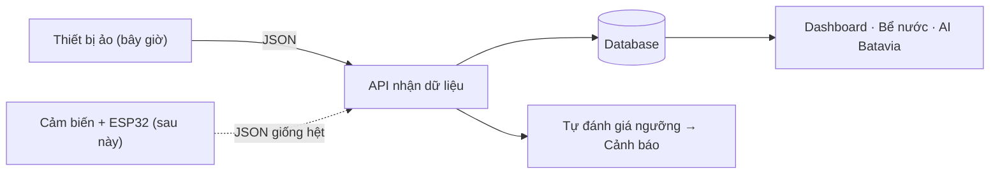

# Hệ thống giả lập IoT và hướng tích hợp thiết bị thật

> Tài liệu dùng cho thuyết trình đồ án HydroSmart: quản lý trang trại thủy canh NFT.
> Phạm vi AI: **chỉ Xà lách Batavia**. Các giống khác (Green Oak, Romaine...) chỉ để minh hoạ chức năng quản lý. Phần AI của các giống này **sẽ phát triển sau**.

---

## 1. Ý tưởng trong 30 giây (nói với giảng viên)

> "Nhóm em chưa có cảm biến thật, nên viết một **phần mềm đóng vai cảm biến** (thiết bị ảo).
> Thiết bị ảo gửi dữ liệu theo **đúng định dạng và đúng địa chỉ API** mà thiết bị thật ESP32 sẽ dùng.
> Vì vậy khi có phần cứng, nhóm chỉ **thay nguồn dữ liệu**. Database, cảnh báo, Dashboard và AI **không phải sửa**."

Ví dụ dễ hiểu: giống như **cắm chuột khác vào cổng USB**. Máy tính không quan tâm chuột hãng nào, miễn là nói đúng "ngôn ngữ" USB. Ở đây, "cổng USB" là API `POST /api/v1/sensors/telemetry/batch`, còn "ngôn ngữ" là gói tin JSON.



Chỉ khối **đầu tiên** thay đổi. Mọi khối phía sau giữ nguyên.

---

## 2. Kịch bản thuyết trình (khoảng 5–7 phút)

### Chuẩn bị (trước giờ thuyết trình)

```powershell
docker compose up -d                        # PostgreSQL
cd backend;  npm run dev                    # cổng 5000
cd frontend; npm run dev                    # cổng 3000
cd ai_service; uvicorn api:app --port 8000  # (tuỳ chọn) AI Batavia
```

1. Đăng nhập bằng tài khoản backend (ví dụ `admin@hydrosmart.farm`).
2. Mở menu **Trạm giả lập IoT** (`http://localhost:3000/simulator`).
3. Bấm **Đặt lại từ đầu** để mọi bể về trạng thái tốt.
4. Bật công tắc **Gợi ý lời nói** (góc phải trên). Mỗi bước sẽ hiện sẵn câu giải thích.

Trang được chia đúng **3 bước** theo thứ tự trình bày:

### Bước ① Hệ thống đang chạy

| Thao tác | Nói gì |
|---|---|
| Bấm **Bắt đầu giả lập** | "Mỗi bể có một thiết bị ảo đo pH, EC, nhiệt độ nước, oxy và mực nước." |
| Chỉ vào 5 ô chỉ số + đồng hồ ngày/đêm | "Mỗi 2 giây ở đây bằng 30 phút ngoài trang trại. Số liệu tính theo quy luật thủy canh, không ngẫu nhiên." |
| Chỉ vào khung **Điều gì đang diễn ra?** | "Cây hút nước nên mực nước giảm, EC tăng nhẹ. Ban ngày nóng hơn ban đêm." |
| Chỉ vào vùng xanh trên biểu đồ | "Vùng xanh là ngưỡng tốt cho Xà lách Batavia." |

### Bước ② Tạo sự cố

| Thao tác | Nói gì |
|---|---|
| Bấm ô **Hỏng máy sục khí** | "Giả sử máy sục khí bị hỏng." |
| Chỉ vào chuỗi **1 → 2 → 3** | "Oxy giảm (1). Khi vượt ngưỡng, hệ thống **tự** tạo cảnh báo (2), không ai nhập tay. Kèm hướng xử lý cho kỹ thuật viên (3)." |
| Bấm **Mở trang Cảnh báo** | "Cảnh báo đã được lưu trong database." |
| Quay lại, bấm **Khôi phục bình thường** | "Oxy hồi phục dần." |

Các sự cố có sẵn:

| Sự cố | Chỉ số thay đổi | Cảnh báo |
|---|---|---|
| Nắng nóng (**cả trang trại**) | Nhiệt độ nước > 25°C, oxy giảm theo | Temp |
| Hỏng máy sục khí | Oxy hoà tan tụt xuống ~3.6 mg/L | DO (EMERGENCY) |
| Cạn dinh dưỡng | EC giảm dưới ngưỡng sau ~8 giờ mô phỏng | EC |
| pH trôi lên kiềm | pH vượt 6.2–6.3 | pH |
| Rò rỉ nước | Mực nước tụt ~4% dung tích mỗi giờ | WaterLevel |
| Mất tín hiệu cảm biến | Cảm biến pH ngừng gửi; sau 3 nhịp chuyển Offline | System |

### Bước ③ Thay bằng thiết bị thật

| Thao tác | Nói gì |
|---|---|
| Chỉ vào sơ đồ 2 hàng | "Hàng trên là bây giờ, hàng dưới là thực tế. Chỉ khối đầu tiên khác nhau." |
| Chỉ vào 2 gói tin JSON đặt cạnh nhau | "Thiết bị ảo và ESP32 gửi cùng một định dạng. Backend xử lý bằng cùng một hàm." |
| Chỉ vào **3 bước** và bảng thiết bị | "Lắp cảm biến, nạp code có sẵn, đổi 2 dòng cấu hình. Chi phí khoảng 5,6 triệu đồng mỗi bể." |
| (Tuỳ chọn) Sao chép lệnh PowerShell và chạy | "Em giả làm một thiết bị bên ngoài gửi pH 5.2." pH đổi ngay và có cảnh báo pH, chứng minh hệ thống nhận dữ liệu từ bên ngoài. |

Kết thúc: mở **Dự báo năng suất AI**, chọn lô Green Oak: "Mô hình AI hiện chỉ huấn luyện cho Batavia, các giống khác hiển thị *phát triển sau*."

---

## 3. Triển khai thực tế: cụ thể phải làm gì?

### 3.1 Thiết bị cho 1 bể

| Chỉ số | Thiết bị đề xuất | Nối với ESP32 | Giá ước tính |
|---|---|---|---|
| pH | DFRobot Gravity pH V2 (SEN0161-V2) | Analog → ADS1115 (I2C) | ~450.000đ |
| EC | DFRobot Gravity EC K=1 (DFR0300) | Analog → ADS1115 | ~1.300.000đ |
| Nhiệt độ nước | DS18B20 chống nước | 1-Wire, GPIO4 | ~40.000đ |
| Oxy hoà tan (DO) | DFRobot Gravity DO (SEN0237) | Analog → ADS1115 | ~3.500.000đ |
| Mực nước | JSN-SR04T siêu âm chống nước | GPIO26/27 | ~120.000đ |
| ADC 16-bit | ADS1115 | I2C (GPIO21/22) | ~60.000đ |
| Vi điều khiển | ESP32 DevKit V1 | Wi-Fi, HTTP | ~120.000đ |
| **Tổng** | | | **~5.590.000đ** |

**Node khí hậu cho mỗi nhà màng:** ESP32, SHT31 (nhiệt độ/ẩm, I2C), BH1750 hoặc cảm biến PAR, tuỳ chọn CO₂ MH-Z19.

### 3.2 Ba bước chuyển đổi

1. **Lắp phần cứng và hiệu chuẩn.** Sơ đồ đấu nối ghi ở đầu file [esp32_hydro_node.ino](../hardware/esp32_hydro_node/esp32_hydro_node.ino).
   - pH: 2 điểm, dung dịch chuẩn 4.0 và 7.0.
   - EC: dung dịch chuẩn 1.413 mS/cm, bù nhiệt bằng DS18B20 (công thức thư viện DFRobot_EC).
   - DO: 1 điểm trong không khí bão hoà, bù nhiệt 35 mV/°C (theo DFRobot).
2. **Nạp firmware**: điền tên Wi-Fi, `SERVER_URL`, `DEVICE_KEY` và mã cảm biến trùng với bảng `sensors` (ví dụ `SEN-PH-01`). Firmware tự lấy giờ qua NTP và gửi kèm `timestamp`.
3. **Đổi cấu hình backend** trong `backend/.env`, rồi khởi động lại:
   ```env
   DATA_SOURCE=device
   DEVICE_API_KEY=mot-chuoi-bi-mat
   ```

Không sửa gì thêm: Database, Rule Engine, Dashboard, cảnh báo và AI Batavia giữ nguyên.

### 3.3 Điều gì thay đổi khi `DATA_SOURCE=device`?

| Hạng mục | Chế độ giả lập | Chế độ thiết bị thật |
|---|---|---|
| Ai gửi dữ liệu | Thiết bị ảo trong backend | ESP32 qua Wi-Fi |
| Nút Bắt đầu / Sự cố / Đặt lại | Dùng được | **Bị khoá** (không ghi đè dữ liệu thật) |
| Phát hiện mất tín hiệu | Trạm giả lập kiểm tra mỗi nhịp (ngưỡng 3 nhịp) | **Watchdog độc lập** kiểm tra mỗi ~15 giây, ngưỡng `DEVICE_STALE_MS` (mặc định 3 phút = 3 chu kỳ gửi của ESP32) |
| Thời điểm ghi log | Giờ thực của server | `timestamp` thiết bị gửi (cho phép gửi bù tối đa 24h khi mất mạng) |
| Xác thực thiết bị | Không cần | Header `x-device-key` phải khớp `DEVICE_API_KEY` |

### 3.4 Gói tin chuẩn (hợp đồng dữ liệu)

```http
POST /api/v1/sensors/telemetry/batch
Content-Type: application/json
x-device-key: <DEVICE_API_KEY>

{
  "deviceId": "ESP32-RES-01",
  "source": "sensor",
  "timestamp": "2026-10-20T10:15:00Z",
  "readings": [
    { "sensorCode": "SEN-PH-01",   "value": 5.92 },
    { "sensorCode": "SEN-EC-01",   "value": 1.74 },
    { "sensorCode": "SEN-TEMP-01", "value": 21.6 },
    { "sensorCode": "SEN-DO-01",   "value": 7.8 },
    { "sensorCode": "SEN-LVL-01",  "value": 88.5 }
  ]
}
```

Node khí hậu gửi một `sensorCode` với nhiều `metric`: `air_temp`, `humidity`, `ppfd`, `dli`, `co2`.

---

## 4. Mô hình mô phỏng (cơ sở khoa học)

| Chỉ số | Quy luật mô phỏng |
|---|---|
| Khí hậu nhà màng | Chu kỳ ngày/đêm: nhiệt độ ~22.5 ± 2°C, ẩm 63–73%, ánh sáng PPFD hình sin (đỉnh ~550 µmol/m²/s), cộng dồn DLI, VPD tính từ nhiệt độ và ẩm |
| Mực nước | Cây thoát hơi nước theo số cây, tuổi cây, ánh sáng và VPD. Bể không mất nước quá mức 3% đáy (đầu hút bơm) |
| EC | Cân bằng khối lượng muối EC × V: nước mất nhanh hơn ion (tỉ lệ 0.9) nên EC **tăng dần**. Muối mất đi luôn khớp với lượng nước thực sự mất |
| pH | Cây hút NO₃⁻ nên pH **trôi lên** chậm (~0.06/ngày) |
| Nhiệt độ nước | Tiến dần về cân bằng nhiệt (độ trễ 4 giờ), có chiller giữ ~21°C |
| DO | Oxy bão hoà phụ thuộc nhiệt độ (công thức APHA). Có sục khí thì DO ≈ 90% bão hoà |
| Tuổi cây | Tính từ ngày gieo. Lô seed đã quá hạn thì ước tính theo giai đoạn sinh trưởng ghi trong DB |
| Nhiễu cảm biến | Nhiễu Gauss nhỏ (pH ±0.015, EC ±0.012...), giống số đo thật |
| Ảnh hưởng tới Batavia | Hệ số sinh trưởng 0–100% so với điều kiện tối ưu, kèm danh sách yếu tố gây stress |

Ngưỡng tối ưu lấy **theo giai đoạn sinh trưởng** của các lô trong bể. Nếu các giống trong cùng bể có ngưỡng xung đột, hệ thống **ưu tiên Batavia**.

**Phát hiện can thiệp của người vận hành:** nếu kỹ sư châm phân, bù nước hoặc xả bể trên màn hình *Bể nước & Dinh dưỡng*, mô hình nhận giá trị mới và tiếp tục mô phỏng từ đó.

---

## 5. Câu hỏi giảng viên có thể hỏi

| Câu hỏi | Gợi ý trả lời |
|---|---|
| Số liệu có phải random không? | Không. Số liệu tính từ mô hình cân bằng nước, muối, nhiệt và oxy (mục 4). Chỉ thêm nhiễu nhỏ giống sai số cảm biến thật. |
| Làm sao chứng minh hệ thống nhận được dữ liệu từ thiết bị bên ngoài? | Chạy lệnh PowerShell ở bước ③: một chương trình **bên ngoài** gửi gói tin qua HTTP, Dashboard và cảnh báo cập nhật ngay. ESP32 làm đúng việc đó. |
| Khi có thiết bị thật phải sửa bao nhiêu code? | Không sửa code backend/frontend. Chỉ nạp firmware cho ESP32 và đổi `DATA_SOURCE=device` trong `.env`. |
| Thiết bị mất Wi-Fi thì sao? | Watchdog phát hiện thiết bị im lặng quá 3 phút → cảm biến chuyển Offline và sinh cảnh báo "Mất tín hiệu". Gửi lại thì cảnh báo tự đóng. |
| Ai cũng gửi dữ liệu giả vào được không? | Thiết bị phải gửi kèm khoá `x-device-key`. Các nút điều khiển giả lập yêu cầu đăng nhập. |
| Tại sao tua nhanh thời gian mà log vẫn theo giờ thật? | Để báo cáo "24h gần nhất" và Dashboard không bị dữ liệu "ở tương lai". Giờ mô phỏng chỉ hiển thị trên trang Trạm giả lập. |
| Vì sao AI chỉ cho Batavia? | Mô hình chỉ có dữ liệu huấn luyện cho Batavia. Các giống khác cần thu thập dữ liệu riêng (hướng phát triển). |

---

## 6. Thành phần mã nguồn

| Thành phần | File | Vai trò |
|---|---|---|
| Mô hình thủy canh | [hydro-model.ts](../backend/src/modules/simulator/hydro-model.ts) | Tính pH, EC, nhiệt độ nước, DO, mực nước, khí hậu |
| Thiết bị ảo | [simulator.service.ts](../backend/src/modules/simulator/simulator.service.ts) | Mỗi bể = 1 node `SIM-RES-xx`, mỗi nhà màng = 1 node `SIM-ENV-xx` |
| API điều khiển | `/api/v1/simulator/*` | `status`, `heartbeat` (không cần đăng nhập); `start`, `stop`, `step`, `speed`, `scenario`, `reset` (cần đăng nhập) |
| API nhận dữ liệu | [sensors.service.ts](../backend/src/modules/sensors/sensors.service.ts) | `POST /sensors/telemetry/batch`, **dùng chung** cho giả lập và thiết bị thật |
| Watchdog thiết bị thật | [device-watchdog.ts](../backend/src/modules/sensors/device-watchdog.ts) | Phát hiện mất tín hiệu khi `DATA_SOURCE=device` |
| Giao diện | [SimulatorView.tsx](../frontend/src/views/SimulatorView.tsx) | 3 bước thuyết trình + gợi ý lời nói |
| Firmware mẫu | [esp32_hydro_node.ino](../hardware/esp32_hydro_node/esp32_hydro_node.ino) | Code ESP32 gửi cùng gói tin |

### Cấu hình (`backend/.env`)

| Biến | Mặc định | Ý nghĩa |
|---|---|---|
| `DATA_SOURCE` | `simulator` | `simulator` cho demo; `device` khi dùng thiết bị thật |
| `SIMULATOR_AUTOSTART` | `false` | Tự bật giả lập khi khởi động backend |
| `SIMULATOR_INTERVAL_MS` | `2000` | Chu kỳ 1 nhịp (ms thực), kẹp trong 1000–10000 |
| `DEVICE_API_KEY` | trống | Khoá thiết bị; để trống thì không kiểm tra |
| `DEVICE_STALE_MS` | `180000` | Thiết bị thật im lặng quá thời gian này thì báo mất tín hiệu |

### Hướng phát triển sau

- Chuyển từ HTTP sang MQTT khi số thiết bị lớn.
- Thêm điều khiển ngược (relay bơm định lượng, chiller).
- Huấn luyện mô hình AI cho các giống khác ngoài Batavia.
